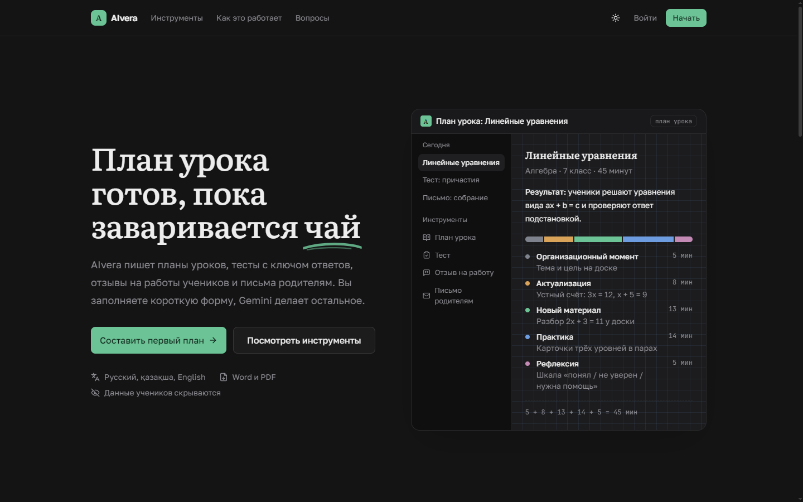
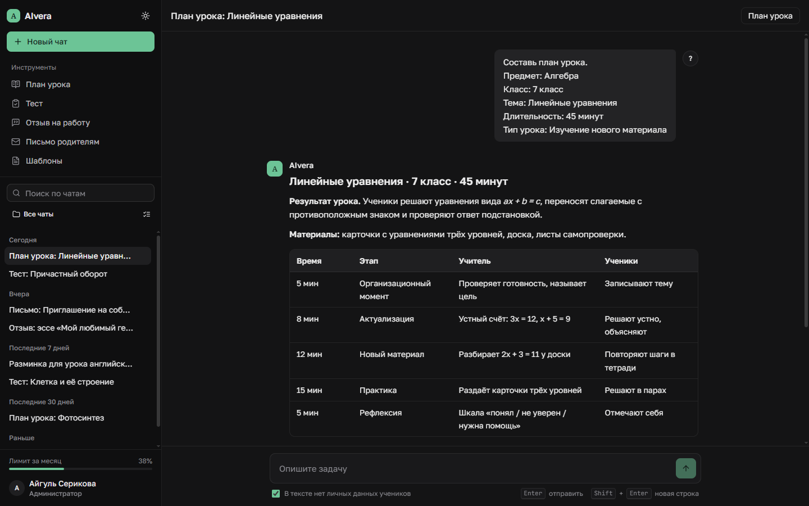
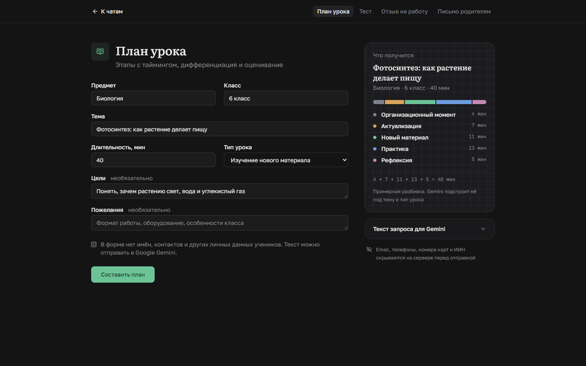
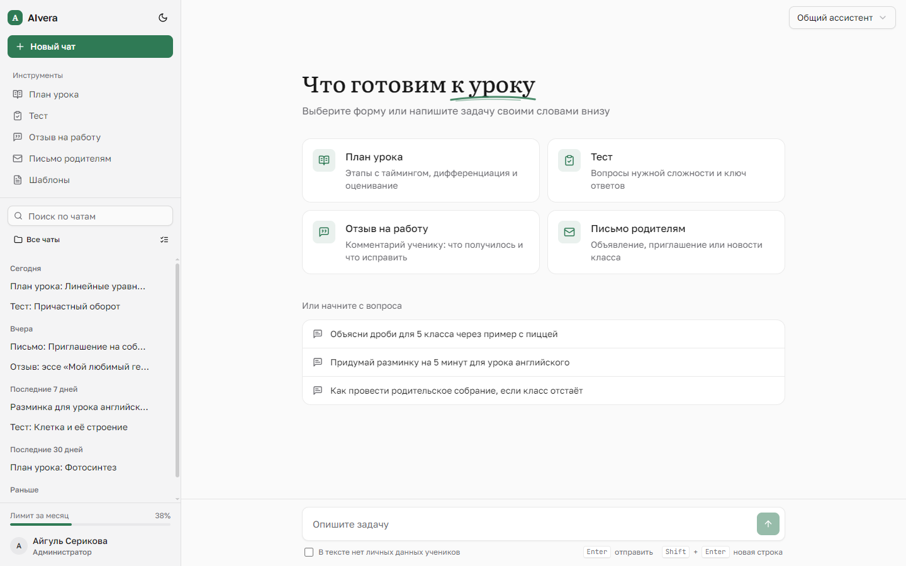
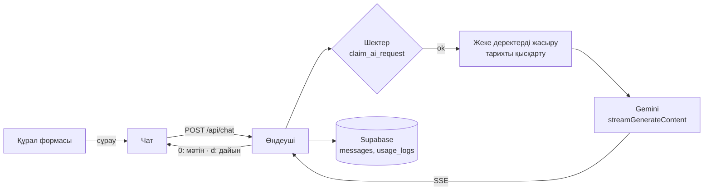

<div align="center">

# AIvera Reimagined

**Мұғалім қысқа форманы толтырады. AIvera сабақ жоспарын, жауап кілті бар тестті, оқушы жұмысына пікірді немесе ата-аналарға хатты қайтарады.**

[](https://github.com/artyom129/aivera-reimagined/actions/workflows/ci.yml)


**🌐 Тіл:** [English](README.md) · [Русский](README.ru.md) · **Қазақша**



</div>

---

## 📌 AIvera не үшін керек

Мұғалімге тағы бір чат-бот керек емес. Мұғалімге ертеңгі сабақ керек: қосындысы дәл 45 минут болатын кезеңдер, мықты оқушыларға және қиналатындарға тапсырмалар, жауаптары дайын тест. AIvera осы дайын құжатқа құрылған, ал чат оны жетілдіру үшін керек.

## 👥 Жоба қайдан шықты

AIvera **AIverse** командасының жобасы ретінде басталды. Мен, [Koncha Artyom](https://github.com/artyom129), сол командада болдым және бастапқы нұсқаның үстінде жұмыс істедім. Идея мен командалық жұмыс AIverse-ке тиесілі. Қосымшаны толығымен менікі деп айтпаймын.

Командалық жоба аяқталғаннан кейін кодты алып, жалғастырдым. Екі кезеңмен.

| Кезең | Не болды | Кім |
| --- | --- | --- |
| Бастапқы AIvera | Идея, алғашқы нұсқа, командалық әзірлеу | AIverse командасы, Koncha Artyom қоса |
| Қалпына келтіру | Жоба қайтадан өз бетімен іске қосылады | Koncha Artyom |
| Қайта ойластыру | Өнім, жасанды интеллектпен жұмыс және дизайн жаңадан ойластырылды | Koncha Artyom |
| Қолдау | Қазір | [Koncha Artyom](https://github.com/artyom129) |

**Қалпына келтіру.** Алғашқы міндет: AIvera команданың инфрақұрылымынсыз жұмыс істеуі. Жаңа жобаға арналған толық Supabase миграциясын жаздым, конфигурацияны, профильдерді және қол жеткізу ережелерін қайта жасадым, кіруді хатты қайта жіберу мен құпиясөзді қалпына келтіруі бар серверлік маршруттарға көшірдім, Gemini-ді серверлік API артына жасырдым, сабақ жоспарының конструкторын, айнымалылар үлгісін және GitHub Actions тексерістерін қостым.

**Қайта ойластыру.** Содан кейін қосымшаны мұғалім сияқты қолданып көрдім және оның мұғалім үшін тағы қаншама нәрсе істей алатынын көрдім. Бұл релиз келесі қадам.

## 🔄 Осы нұсқада не жаңа

| Не | Қазір қалай жұмыс істейді |
| --- | --- |
| Құралдар | Төрт форма: сабақ жоспары, тест, жұмысқа пікір, ата-аналарға хат. Әрқайсысында Gemini-ге қандай мәтін кететіні көрінеді |
| Жауаптар | Әр режимге өз шегі, 4096-ға дейін, ал жауап әлі сыймаса **Жалғастыру** батырмасы |
| Сақтау | Әр жауапты сервер сақтайды, **Тоқтату** басылғандағы жартылай жауапты да |
| Экспорт | **Word**, **басып шығару / PDF**, Markdown және соңғы жауапқа **Басқа нұсқа** |
| Тіл | Жауаптар орыс, қазақ немесе ағылшын тілінде, баптауларда таңдалады |
| Токен шегі | Айлық шек, әр айдың 1-інде нөлге түседі. Әкімші оны көтеріп не есептегішті тастай алады |
| Деректерді жасыру | Тек нақты телефон, карта нөмірі (Лун тексеруі) және ЖСН (бақылау саны) жасырылады |
| Қауіпсіздік сүзгісі | Зиянды нұсқаулық сұраулары бұғатталады. Мектеп тақырыптары өтеді |
| Интерфейс | Ойластырылған дизайн, қалыпты диалогтар, барлық бетте ашық және қараңғы тақырып |
| Тесттер | 67 юнит-тест, CI-да lint, typecheck және құрастырумен бірге |

### 🎨 Дизайн

Интерфейске бір идея бердім: мұғалімнің үстелі. Графит беттер, мектеп тақтасы түсіндегі бір акцент, интерфейске Golos Text, тақырыптарға Literata. Екі қаріп те кириллицаны толық қолдайды және қосымшамен бірге жеткізіледі.

Түс бір жерге жиналған, сабақ кезеңдерінің шкаласына. Әр түс бір кезеңді білдіреді, ені оның уақыттағы үлесін көрсетеді. Сабақ жоспары формасында шкала тор дәптер парағында тұрады және ұзақтықты өзгерткенде қайта салынады. Одан басқа бір ғана белгі бар: тақырыптағы негізгі сөздің астындағы бор сызығы.

| Сабақ жоспары бар чат | Сабақ жоспарының формасы |
| --- | --- |
|  |  |



## ✨ Ішінде не бар

| Бөлім | Не істейді |
| --- | --- |
| Құралдар | Сабақ жоспары, тест, оқушы жұмысына пікір, ата-аналарға хат |
| Чат | Жауап жазылған сайын шығады, төрт режим, қалталары, іздеуі және күн бойынша топтары бар тарих |
| Жауаптар | Көшіру, Word, басып шығару немесе PDF, Markdown, басқа нұсқа, үзілген жауапты жалғастыру |
| Үлгілер | Жеке және ортақ. `{Жақшадағы}` өрістер мәтіннен өздігінен табылады |
| Аккаунт | Поштаны растаумен тіркелу, кіру, құпиясөзді қалпына келтіру |
| Баптаулар | Аты, жауап тілі, тақырып, айлық шектің жұмсалуы |
| Әкімші | Күндер мен модельдер бойынша шығын, пайдаланушылар (шектер, тастау, себебімен бұғаттау, рөлдер), үлгілерді модерациялау, модель таңдау |

## 🔄 Сұраудың жолы



`claim_ai_request` `ok`, `rate_limited`, `quota_exceeded` немесе `blocked` деп жауап береді, сондықтан мұғалім не болғанын нақты көреді. Ағын аяқталғанда жауап дерекқорға жазылады, браузер жабылып қалса да.

## 🛡️ Gemini және оқушылардың деректері

| Шара | Қалай жұмыс істейді |
| --- | --- |
| API кілті | Серверде сақталады. Браузер оны көрмейді |
| Келісім | Жіберер алдында мұғалім мәтінде жеке деректер жоқ екенін растайды |
| Жасыру | Email, телефон, карта нөмірі және ЖСН сұраудан алынып тасталады |
| Контекст | Соңғы 16 хабарлама, 60 000 таңбаға сыю үшін ескілері кесіледі |
| Жиілік | Бір пайдаланушыға минутына 12 сұрау |
| Айлық шек | Әкімші әр адамға белгілейді, 1-інде нөлге түседі |
| Файлдар мен суреттер | Жүктеу жоқ. Жауаптардағы сыртқы суреттер жүктелмейді |

## 🗄️ Дерекқор

| Кесте | Не үшін |
| --- | --- |
| `users` | Профиль, рөл (`teacher` / `admin`), жауап тілі, айлық шек және жұмсалуы |
| `folders` | Пайдаланушы қалталары |
| `chats` | Диалогтар және олардың режимі |
| `messages` | Мұғалімнің хабарламалары және ЖИ жауаптары |
| `templates` | Жеке және ортақ үлгілер |
| `usage_logs` | Сұраулар мен модельдер бойынша токендер |
| `audit_logs` | Әкімшілердің әрекеттері |
| `ai_request_log` | Сұрау жиілігін шектеу |
| `app_settings` | Қосымша баптаулары, Gemini моделін қоса |

RLS барлық кестеде қосулы. Мұғалім тек өз чаттарын, қалталарын және үлгілерін, сондай-ақ ортақ үлгілерді көреді. Әкімші құқықтары дерекқордың ішінде тексеріледі.

## 🚀 Жылдам бастау

**Node.js 22**, Supabase жобасы және Gemini кілті керек.

```bash
git clone https://github.com/artyom129/aivera-reimagined.git
cd aivera-reimagined
npm ci
```

**Дерекқор.** Supabase SQL Editor-да екі миграцияны ретімен орындаңыз:

1. [`20260928000000_initial_aivera.sql`](supabase/migrations/20260928000000_initial_aivera.sql): кестелер, RLS, функциялар, триггерлер
2. [`20261115000000_monthly_quota_and_daily_analytics.sql`](supabase/migrations/20261115000000_monthly_quota_and_daily_analytics.sql): айлық шек және аналитика

**Айнымалылар.** `.env.example` файлын `.env.local` етіп көшіріп, толтырыңыз:

| Айнымалы | Не үшін |
| --- | --- |
| `NEXT_PUBLIC_SUPABASE_URL` | Жоба мекенжайы |
| `NEXT_PUBLIC_SUPABASE_ANON_KEY` | Ашық кілт (anon / publishable) |
| `GEMINI_API_KEY` | Google AI Studio кілті, тек серверде қолданылады |
| `ALLOWED_DEV_ORIGINS` | Міндетті емес: жергілікті желідегі dev-сервер мекенжайлары |

Service-role кілті керек емес. `.env.local` Git-ке түспейді.

**Кіру мекенжайлары.** Supabase → Authentication → URL Configuration бөлімінде Site URL ретінде `http://localhost:3000` көрсетіп, `http://localhost:3000/auth/callback**` redirect URL қосыңыз.

```bash
npm run dev
```

Тіркеліп, поштаны растаңыз, профильді дерекқордағы триггер жасайды. Әкімші болу үшін SQL Editor-да орындап, қайта кіріңіз:

```sql
update public.users set role = 'admin' where email = 'you@example.com';
```

## 📦 Продакшнға шығару

1. Екі миграцияны негізгі Supabase жобасына қолданыңыз.
2. Хостингте айнымалыларды орнатыңыз.
3. Supabase-ке доменіңізді және callback мекенжайларын қосыңыз, `?next=/chat` және `?next=/auth/update-password` қоса.
4. `npm run build` арқылы құрастырып, `npm run start` арқылы іске қосыңыз немесе Next.js қолдайтын кез келген платформаға шығарыңыз.
5. Тіркелуді, кіруді, құпиясөзді қалпына келтіруді, формадан жасалған сабақ жоспарын, экспортты және әкімші панелін тексеріңіз.

## 🧪 Тексерулер

| Команда | Не істейді |
| --- | --- |
| `npm test` | Vitest-тегі 67 юнит-тест |
| `npm run lint` | ESLint |
| `npm run typecheck` | TypeScript |
| `npm run build` | Продакшн құрастыру |

Тесттер жеке деректерді жасыруды (оқу материалы одан зардап шекпейтінін де), қауіпсіздік сүзгісін, ағынды хаттаманы және SSE талдауын, тарихты қысқартуды, формалардың сұраулары мен тексерісін, кезең шкаласын, үлгілерді, шекті есептеуді және экспортты тексереді. CI әр push сайын төрт команданың бәрін іске қосады.

## 📂 Құрылым

```text
app/
├── api/chat/          # Gemini ағынды жауаптары, шектер, сақтау
├── tools/[tool]/      # Формалар: жоспар, тест, пікір, хат
├── chat/              # Жұмыс кеңістігі
├── templates/  settings/  admin/  auth/
components/
├── chat/              # Бүйір панель, хабарламалар, енгізу өрісі
├── tools/  templates/  settings/  admin/  auth/
├── lesson-timeline.tsx
lib/
├── ai/                # sanitize, safety, stream, history, client
├── tools.ts           # Форма өрістері және сұрау құрастыру
├── ai-config.ts       # Режимдер, жүйелік нұсқаулар, жауап тілі
supabase/migrations/   # Схема, RLS, функциялар
tests/                 # Vitest
```

## ⚠️ Шектеулер

- Деректерді жасыру бәрін ұстай бермейді. Жіберер алдында мұғалімнен аттарды алып тастап, растауын сұрайды.
- Gemini қателеседі. Материалды сабаққа апармас бұрын оқып шығыңыз.
- Файл жүктеу және сканерленген мәтінді тану жоқ.

## 🧰 Технологиялар

Next.js 16 · React 19 · TypeScript · Tailwind CSS 4 · Radix UI · Supabase (Postgres, Auth, RLS) · Google Gemini · Recharts · Vitest · GitHub Actions

---

<div align="center">

*Бастапқы командалық жоба: AIverse. Қалпына келтірген, қайта ойластырған және дамытқан [Koncha Artyom](https://github.com/artyom129).*

</div>
