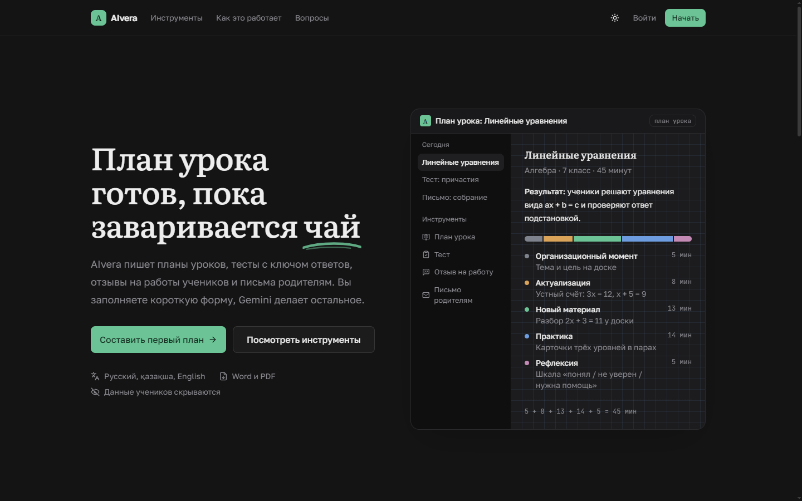
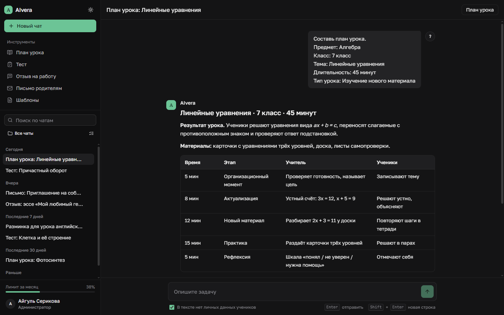
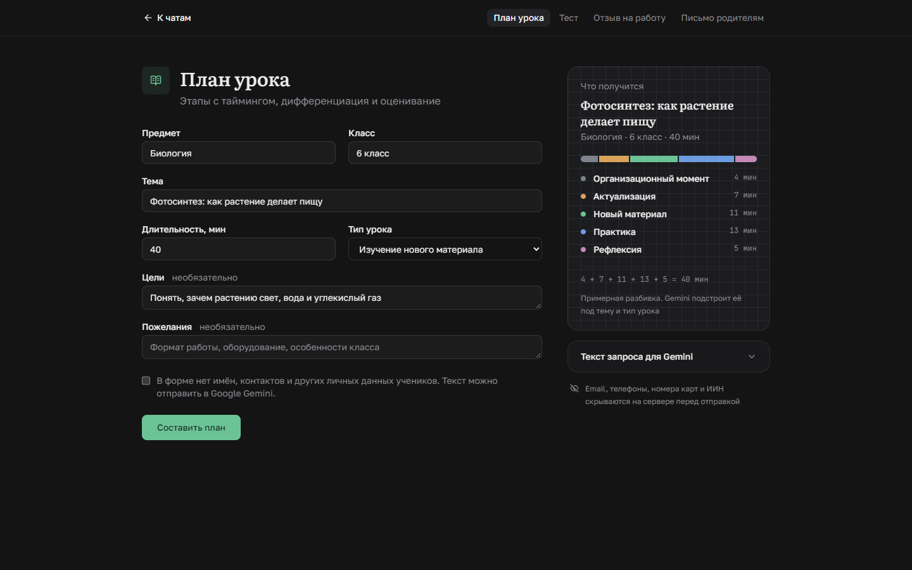
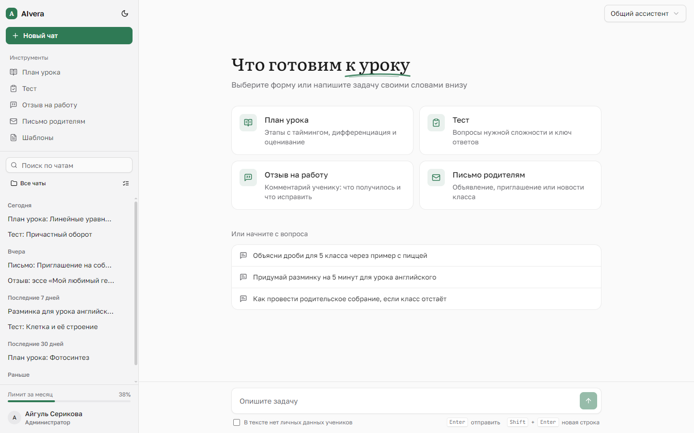
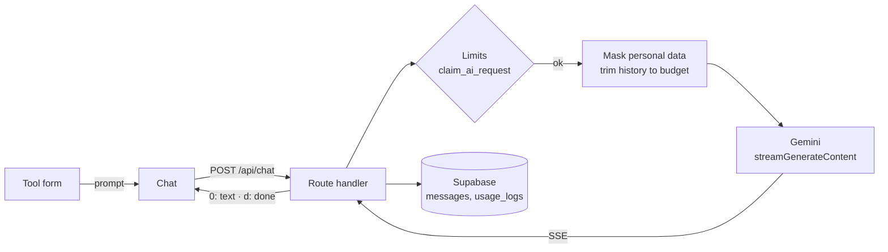

<div align="center">

# AIvera Reimagined

**Teachers fill in a short form. AIvera hands back a lesson plan, a test with an answer key, feedback on a student's work or a letter to parents.**

[](https://github.com/artyom129/aivera-reimagined/actions/workflows/ci.yml)


**🌐 Language:** **English** · [Русский](README.ru.md) · [Қазақша](README.kk.md)



</div>

---

## 📌 Why AIvera exists

A teacher does not need another chatbot. A teacher needs tomorrow's lesson: stages that add up to 45 minutes, tasks for the strong and the struggling, a test with the answers already worked out. AIvera is built around that finished document, and the chat is where you refine it.

## 👥 Where it came from

AIvera began as a team project at **AIverse**. I, [Koncha Artyom](https://github.com/artyom129), was on that team and worked on the original. The idea and the team's work belong to AIverse. I do not claim the application as mine alone.

After the team project ended I took the code and kept going, in two stages.

| Stage | What happened | Who |
| --- | --- | --- |
| Original AIvera | The idea, the first version, the team build | AIverse team, including Koncha Artyom |
| Restoration | Got the project running on its own again | Koncha Artyom |
| Reimagining | Rethought the product, the AI pipeline and the design | Koncha Artyom |
| Maintenance | Ongoing | [Koncha Artyom](https://github.com/artyom129) |

**Restoration.** The first job was to make AIvera stand up without the team's infrastructure. I wrote a complete Supabase migration for a fresh project, reworked configuration, profiles and access rules, moved sign-in to server routes with confirmation resend and password recovery, put Gemini behind a server API, added the lesson-plan builder and set up an environment template and GitHub Actions checks.

**Reimagining.** Then I used it the way a teacher would, and found where it let them down. This release is the answer.

## 🔄 What I changed and why

| Area | What I found | What I did |
| --- | --- | --- |
| Tools | Only the lesson plan had a form. Tests and feedback dropped the teacher into an empty chat | Four forms: lesson plan, test, feedback on student work, letter to parents. Each one shows the exact text that will go to Gemini |
| Answers | Every mode stopped at 900 tokens, so a lesson plan with a stage table never finished | A limit sized for each mode, up to 4,096, and a **Continue** button when an answer still runs out |
| Saving | The browser saved the answer, so switching chats or closing the tab threw it away | The server saves every answer, including a partial one after **Stop** |
| Export | Copy and nothing else | **Word**, **print / PDF**, Markdown, and **Another version** for the last answer |
| Language | `users.language` sat in the database and did nothing | Answers in Russian, Kazakh or English, chosen in Settings |
| Token limit | A lifetime counter: after 100k tokens a teacher was locked out for good | A monthly limit that resets on the 1st. Admins can raise it or reset the counter |
| Privacy filter | Any run of 10 to 19 digits was masked, which wrecked number series, dates and timetables | Only real phone numbers, card numbers (Luhn check) and ИИН (checksum) are masked |
| Safety filter | Words like "terror", "weapon", "drugs" and "rates" were blocked outright | Requests for harmful instructions are blocked. School topics go through |
| Interface | Stock shadcn, sparkle icons, browser `prompt()` and `alert()` | A designed interface, real dialogs, light and dark themes on every page |
| Tests | None | 67 unit tests, run in CI with lint, typecheck and build |

### 🎨 Design

I gave the interface one idea: a teacher's desk. Graphite surfaces, one chalkboard-green accent, Golos Text for the interface and Literata for headlines. Both fonts cover Cyrillic in full and ship with the app.

The colour goes into one place, the lesson timeline. Each colour is a stage of the lesson and its width is that stage's share of the time. On the lesson-plan form it sits on squared exercise-book paper and redraws as you change the duration. The only other flourish is a chalk underline under the key word of a headline.

| Chat with a lesson plan | Lesson-plan form |
| --- | --- |
|  |  |



## ✨ What's inside

| Area | What it does |
| --- | --- |
| Tools | Lesson plan, test, feedback on student work, letter to parents |
| Chat | Streaming answers, four modes, history with folders, search and date groups |
| Answers | Copy, Word, print or PDF, Markdown, another version, continue a cut answer |
| Templates | Personal and shared. Fields in `{braces}` are picked up from the text automatically |
| Accounts | Sign up with email confirmation, sign in, password recovery |
| Settings | Name, answer language, theme, usage this month |
| Admin | Usage by day and by model, users (limits, reset, block with a reason, roles), template moderation, model choice |

## 🔄 How a request travels



`claim_ai_request` answers `ok`, `rate_limited`, `quota_exceeded` or `blocked`, so the teacher is told what actually happened. The answer is written to the database when the stream ends, whether or not the browser is still there.

## 🛡️ Gemini and student data

| Measure | How it works |
| --- | --- |
| API key | Lives on the server. The browser never sees it |
| Consent | The teacher confirms there is no personal data before anything is sent |
| Masking | Emails, phone numbers, card numbers and ИИН are removed before the request |
| Context | The latest 16 messages, trimmed from the oldest to fit 60,000 characters |
| Rate limit | 12 AI requests per minute per user |
| Monthly limit | Set per user by an admin, resets on the 1st |
| Files and images | No uploads. External images in answers are never loaded |

## 🗄️ Database

| Table | Purpose |
| --- | --- |
| `users` | Profile, role (`teacher` / `admin`), answer language, monthly limit and usage |
| `folders` | User folders |
| `chats` | Conversations and their AI mode |
| `messages` | Teacher messages and AI answers |
| `templates` | Personal and shared templates |
| `usage_logs` | Tokens per request and model |
| `audit_logs` | Admin actions |
| `ai_request_log` | Per-minute rate limiting |
| `app_settings` | App settings, including the Gemini model |

Row-level security is on for every table. A teacher sees only their own chats, folders and templates, plus shared templates. Admin actions go through checked database functions.

## 🚀 Quick start

You need **Node.js 22**, a Supabase project and a Gemini API key.

```bash
git clone https://github.com/artyom129/aivera-reimagined.git
cd aivera-reimagined
npm ci
```

**Database.** Run both migrations in the Supabase SQL Editor, in this order:

1. [`20260928000000_initial_aivera.sql`](supabase/migrations/20260928000000_initial_aivera.sql): tables, RLS, functions, triggers
2. [`20261115000000_monthly_quota_and_daily_analytics.sql`](supabase/migrations/20261115000000_monthly_quota_and_daily_analytics.sql): monthly quota and analytics

**Environment.** Copy `.env.example` to `.env.local` and fill it in:

| Variable | Purpose |
| --- | --- |
| `NEXT_PUBLIC_SUPABASE_URL` | Project URL |
| `NEXT_PUBLIC_SUPABASE_ANON_KEY` | Anon (publishable) key |
| `GEMINI_API_KEY` | Google AI Studio key, used on the server only |
| `ALLOWED_DEV_ORIGINS` | Optional: extra hosts for the dev server on a LAN |

No service-role key is needed. `.env.local` is ignored by Git.

**Auth redirects.** In Supabase → Authentication → URL Configuration, set the Site URL to `http://localhost:3000` and add `http://localhost:3000/auth/callback**` as a redirect URL.

```bash
npm run dev
```

Sign up, confirm the email, and a database trigger creates your profile. For admin access run this in the SQL Editor and sign in again:

```sql
update public.users set role = 'admin' where email = 'you@example.com';
```

## 📦 Going to production

1. Apply both migrations to the production Supabase project.
2. Set the environment variables on your host.
3. Add your domain and its callback URLs in Supabase, including `?next=/chat` and `?next=/auth/update-password`.
4. Build with `npm run build` and start with `npm run start`, or deploy to any platform that runs Next.js.
5. Check sign-up, sign-in, password recovery, a lesson plan from the form, export and the admin panel.

## 🧪 Checks

| Command | What it runs |
| --- | --- |
| `npm test` | 67 Vitest unit tests |
| `npm run lint` | ESLint |
| `npm run typecheck` | TypeScript |
| `npm run build` | Production build |

The tests cover personal-data masking (and prove lesson content survives it), the safety filter, the streaming protocol and SSE parsing, history trimming, form prompts and validation, the lesson timeline, templates, usage and export. CI runs all four commands on every push.

<details>
<summary>🐛 Problems found and fixed in this version</summary>

<br>

- **Lesson plans stopped halfway.** `maxOutputTokens` was 900 in every mode. A plan with a stage table, differentiation and homework needs several thousand.
- **Answers disappeared.** The browser saved the answer only after the stream ended. Switching chats or closing the tab lost it, and Stop threw away the text already written.
- **A race when starting a new chat.** Creating the chat changed the selected chat, and the effect watching that aborted the request that had just begun.
- **Lesson material was treated as personal data.** "2, 4, 6, 8, 10, 12", "2026-09-01, 2026-09-15" and a bell schedule came out as `[телефон скрыт]` or `[номер скрыт]`, including inside earlier answers sent back as context.
- **The keyword filter blocked the curriculum.** "Красный террор", "профилактика наркомании" and "процентные ставки" were rejected.
- **The token limit lasted forever.** `tokens_used` never reset, so a teacher who hit the limit once stayed locked out.
- **Line breaks vanished from the teacher's messages.** A prompt from a form showed up as one long line.
- **Lesson-plan tables broke the layout.** Cells had `white-space: nowrap` and nothing to scroll in.
- **Dark mode only worked in the chat.** A button in the chat sidebar applied it, so every other page loaded light.
- **The admin chart was invisible.** It used `hsl(var(--primary))` on variables stored as `oklch`, and it drew every usage row as its own point.
- **The admin menu had no Templates link**, the sidebar did not fit on a phone, and there was no way to change a limit or block someone with a reason.
- **The templates API returned 500** for a template that did not exist or belonged to someone else.
- **Leftovers from the generator template**: the v0 logo as the favicon, unused placeholder images and an unused users table component.

</details>

## 📂 Project layout

```text
app/
├── api/chat/          # Gemini streaming, limits, saving answers
├── tools/[tool]/      # Lesson plan, test, feedback, letter forms
├── chat/              # Workspace
├── templates/  settings/  admin/  auth/
components/
├── chat/              # Sidebar, messages, composer
├── tools/  templates/  settings/  admin/  auth/
├── lesson-timeline.tsx
lib/
├── ai/                # sanitize, safety, stream, history, client
├── tools.ts           # Form fields and prompt builders
├── ai-config.ts       # Modes, system prompts, answer language
supabase/migrations/   # Schema, RLS, functions
tests/                 # Vitest
```

## ⚠️ Limits

- Masking misses things. Teachers are asked to leave out student names and confirm it before anything is sent.
- Gemini makes mistakes. Read the material before you take it into class.
- There is no file upload and no OCR.

## 🧰 Tech stack

Next.js 16 · React 19 · TypeScript · Tailwind CSS 4 · Radix UI · Supabase (Postgres, Auth, RLS) · Google Gemini · Recharts · Vitest · GitHub Actions

---

<div align="center">

*Original team project: AIverse. Restored, rethought and taken further by [Koncha Artyom](https://github.com/artyom129).*

</div>
