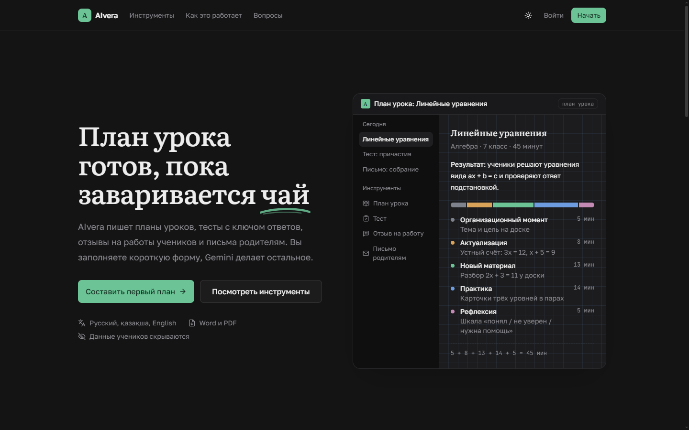
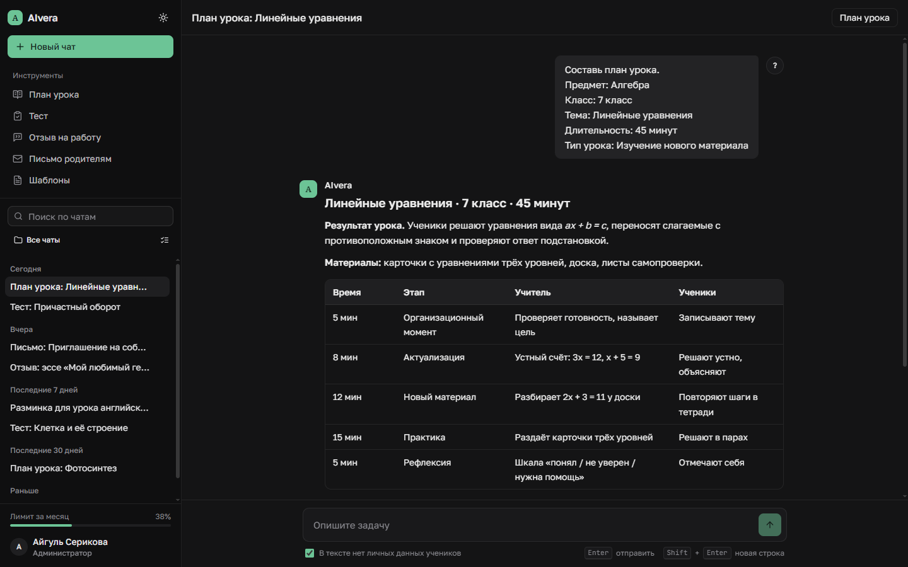
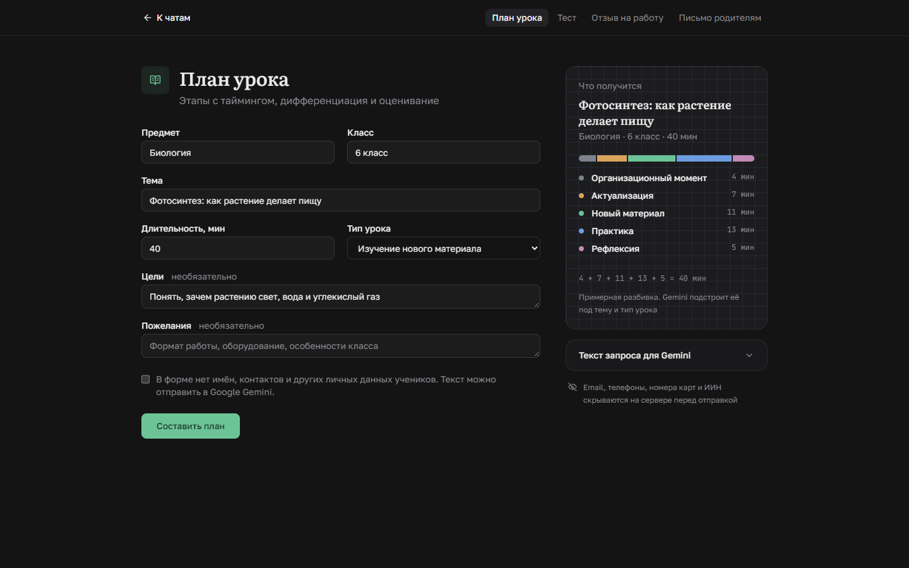
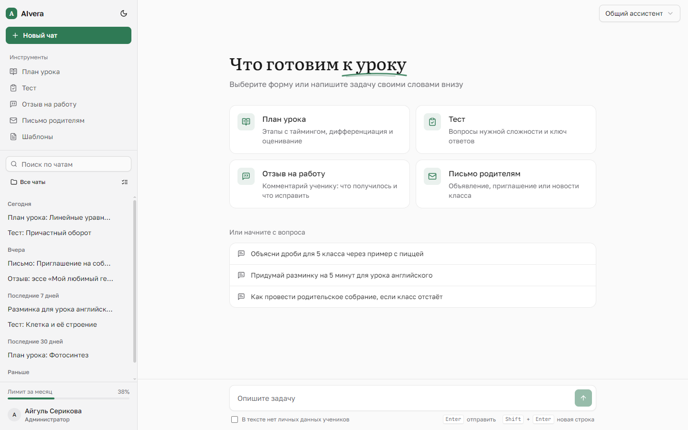
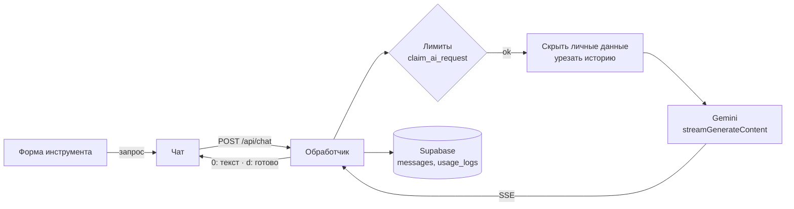

<div align="center">

# AIvera Reimagined

**Учитель заполняет короткую форму. AIvera возвращает план урока, тест с ключом ответов, отзыв на работу ученика или письмо родителям.**

[](https://github.com/artyom129/aivera-reimagined/actions/workflows/ci.yml)


**🌐 Язык:** [English](README.md) · **Русский** · [Қазақша](README.kk.md)



</div>

---

## 📌 Зачем AIvera

Учителю не нужен ещё один чат-бот. Учителю нужен завтрашний урок: этапы, которые в сумме дают ровно 45 минут, задания для сильных и для тех, кому трудно, тест с уже готовыми ответами. AIvera строится вокруг этого готового документа, а чат нужен, чтобы его доработать.

## 👥 Откуда проект

AIvera начиналась как командный проект **AIverse**. Я, [Koncha Artyom](https://github.com/artyom129), был в этой команде и работал над исходной версией. Идея и командная работа принадлежат AIverse. Я не утверждаю, что приложение целиком моё.

Когда командный проект закончился, я забрал код и продолжил. В два этапа.

| Этап | Что произошло | Кто |
| --- | --- | --- |
| Исходная AIvera | Идея, первая версия, командная разработка | Команда AIverse, включая Koncha Artyom |
| Восстановление | Проект снова запускается сам по себе | Koncha Artyom |
| Переосмысление | Продукт, работа с ИИ и дизайн продуманы заново | Koncha Artyom |
| Поддержка | Сейчас | [Koncha Artyom](https://github.com/artyom129) |

**Восстановление.** Первая задача: чтобы AIvera работала без инфраструктуры команды. Я написал полную миграцию Supabase для нового проекта, переделал конфигурацию, профили и правила доступа, перенёс вход на серверные маршруты с повторной отправкой письма и восстановлением пароля, спрятал Gemini за серверным API, добавил конструктор плана урока, шаблон переменных окружения и проверки в GitHub Actions.

**Переосмысление.** Потом я прошёл по приложению так, как прошёл бы учитель, и увидел, сколько ещё оно может для него сделать. Этот релиз и есть следующий шаг.

## 🔄 Что нового в этой версии

| Что | Как теперь работает |
| --- | --- |
| Инструменты | Четыре формы: план урока, тест, отзыв на работу, письмо родителям. В каждой видно, какой именно текст уйдёт в Gemini |
| Ответы | Свой лимит для каждого режима, до 4096, и кнопка **Продолжить**, если ответ всё же не поместился |
| Сохранение | Каждый ответ сохраняет сервер, в том числе недописанный после **Стоп** |
| Экспорт | **Word**, **печать / PDF**, Markdown и **Другой вариант** для последнего ответа |
| Язык | Ответы на русском, казахском или английском, выбор в настройках |
| Лимит токенов | Месячный лимит, обнуляется первого числа. Админ может поднять его или сбросить счётчик |
| Скрытие данных | Скрываются только настоящие телефоны, номера карт (проверка Луна) и ИИН (контрольная цифра) |
| Фильтр безопасности | Блокируются просьбы о вредных инструкциях. Школьные темы проходят |
| Интерфейс | Продуманный дизайн, нормальные диалоги, светлая и тёмная тема на всех страницах |
| Тесты | 67 юнит-тестов, в CI вместе с lint, typecheck и сборкой |

### 🎨 Дизайн

Я дал интерфейсу одну идею: учительский стол. Графитовые поверхности, один акцент цвета школьной доски, Golos Text для интерфейса и Literata для заголовков. Оба шрифта полностью поддерживают кириллицу и поставляются вместе с приложением.

Цвет собран в одном месте, в шкале этапов урока. Каждый цвет означает этап, а ширина показывает его долю времени. В форме плана урока шкала лежит на листе в клетку и перестраивается, когда меняешь длительность. Кроме неё есть одна деталь: меловое подчёркивание под ключевым словом заголовка.

| Чат с планом урока | Форма плана урока |
| --- | --- |
|  |  |



## ✨ Что внутри

| Раздел | Что умеет |
| --- | --- |
| Инструменты | План урока, тест, отзыв на работу ученика, письмо родителям |
| Чат | Ответ появляется по мере генерации, четыре режима, история с папками, поиском и группами по датам |
| Ответы | Копировать, Word, печать или PDF, Markdown, другой вариант, продолжить обрезанный ответ |
| Шаблоны | Личные и общие. Поля в `{фигурных скобках}` находятся в тексте автоматически |
| Аккаунт | Регистрация с подтверждением почты, вход, восстановление пароля |
| Настройки | Имя, язык ответов, тема, расход лимита за месяц |
| Админка | Расход по дням и моделям, пользователи (лимиты, сброс, блокировка с причиной, роли), модерация шаблонов, выбор модели |

## 🔄 Путь запроса



`claim_ai_request` отвечает `ok`, `rate_limited`, `quota_exceeded` или `blocked`, поэтому учитель видит, что на самом деле случилось. Ответ записывается в базу, когда поток заканчивается, даже если браузер уже закрыт.

## 🛡️ Gemini и данные учеников

| Мера | Как работает |
| --- | --- |
| Ключ API | Хранится на сервере. Браузер его не видит |
| Согласие | Учитель подтверждает, что в тексте нет личных данных, до отправки |
| Скрытие | Email, телефоны, номера карт и ИИН убираются из запроса |
| Контекст | Последние 16 сообщений, старые отсекаются, чтобы уложиться в 60 000 символов |
| Частота | 12 запросов к ИИ в минуту на пользователя |
| Месячный лимит | Задаётся админом для каждого, обнуляется первого числа |
| Файлы и картинки | Загрузки нет. Внешние изображения в ответах не загружаются |

## 🗄️ База данных

| Таблица | Зачем |
| --- | --- |
| `users` | Профиль, роль (`teacher` / `admin`), язык ответов, месячный лимит и расход |
| `folders` | Папки пользователя |
| `chats` | Диалоги и их режим |
| `messages` | Сообщения учителя и ответы ИИ |
| `templates` | Личные и общие шаблоны |
| `usage_logs` | Токены по запросам и моделям |
| `audit_logs` | Действия администраторов |
| `ai_request_log` | Ограничение частоты запросов |
| `app_settings` | Настройки приложения, включая модель Gemini |

RLS включён на всех таблицах. Учитель видит только свои чаты, папки и шаблоны, плюс общие шаблоны. Права администратора проверяются внутри базы.

## 🚀 Быстрый старт

Нужны **Node.js 22**, проект Supabase и ключ Gemini.

```bash
git clone https://github.com/artyom129/aivera-reimagined.git
cd aivera-reimagined
npm ci
```

**База данных.** Выполните обе миграции в Supabase SQL Editor по порядку:

1. [`20260928000000_initial_aivera.sql`](supabase/migrations/20260928000000_initial_aivera.sql): таблицы, RLS, функции, триггеры
2. [`20261115000000_monthly_quota_and_daily_analytics.sql`](supabase/migrations/20261115000000_monthly_quota_and_daily_analytics.sql): месячный лимит и аналитика

**Переменные.** Скопируйте `.env.example` в `.env.local` и заполните:

| Переменная | Зачем |
| --- | --- |
| `NEXT_PUBLIC_SUPABASE_URL` | Адрес проекта |
| `NEXT_PUBLIC_SUPABASE_ANON_KEY` | Публичный ключ (anon / publishable) |
| `GEMINI_API_KEY` | Ключ из Google AI Studio, используется только на сервере |
| `ALLOWED_DEV_ORIGINS` | Необязательно: адреса для dev-сервера в локальной сети |

Ключ service-role не нужен. `.env.local` в Git не попадает.

**Адреса для входа.** В Supabase → Authentication → URL Configuration укажите Site URL `http://localhost:3000` и добавьте redirect URL `http://localhost:3000/auth/callback**`.

```bash
npm run dev
```

Зарегистрируйтесь и подтвердите почту, профиль создаст триггер в базе. Чтобы стать администратором, выполните в SQL Editor и войдите заново:

```sql
update public.users set role = 'admin' where email = 'you@example.com';
```

## 📦 Выкладка в продакшен

1. Примените обе миграции к боевому проекту Supabase.
2. Задайте переменные окружения на хостинге.
3. Добавьте свой домен и адреса callback в Supabase, включая `?next=/chat` и `?next=/auth/update-password`.
4. Соберите `npm run build` и запустите `npm run start` или выложите на любую платформу с Next.js.
5. Проверьте регистрацию, вход, восстановление пароля, план урока из формы, экспорт и админку.

## 🧪 Проверки

| Команда | Что делает |
| --- | --- |
| `npm test` | 67 юнит-тестов на Vitest |
| `npm run lint` | ESLint |
| `npm run typecheck` | TypeScript |
| `npm run build` | Продакшен-сборка |

Тесты проверяют скрытие личных данных (и доказывают, что учебный материал от него не страдает), фильтр безопасности, потоковый протокол и разбор SSE, урезание истории, запросы и проверку форм, шкалу этапов, шаблоны, учёт лимита и экспорт. CI запускает все четыре команды при каждом пуше.

## 📂 Структура

```text
app/
├── api/chat/          # Потоковые ответы Gemini, лимиты, сохранение
├── tools/[tool]/      # Формы: план урока, тест, отзыв, письмо
├── chat/              # Рабочее пространство
├── templates/  settings/  admin/  auth/
components/
├── chat/              # Боковая панель, сообщения, поле ввода
├── tools/  templates/  settings/  admin/  auth/
├── lesson-timeline.tsx
lib/
├── ai/                # sanitize, safety, stream, history, client
├── tools.ts           # Поля форм и сборка запросов
├── ai-config.ts       # Режимы, системные инструкции, язык ответа
supabase/migrations/   # Схема, RLS, функции
tests/                 # Vitest
```

## ⚠️ Ограничения

- Скрытие данных ловит не всё. Перед отправкой учителя просят убрать имена и подтвердить это.
- Gemini ошибается. Прочитайте материал, прежде чем нести его на урок.
- Загрузки файлов и распознавания сканов нет.

## 🧰 Технологии

Next.js 16 · React 19 · TypeScript · Tailwind CSS 4 · Radix UI · Supabase (Postgres, Auth, RLS) · Google Gemini · Recharts · Vitest · GitHub Actions

---

<div align="center">

*Исходный командный проект: AIverse. Восстановлен, переосмыслен и развит [Koncha Artyom](https://github.com/artyom129).*

</div>
